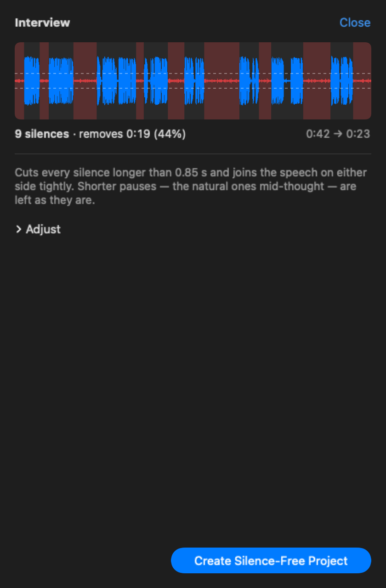

# Silence Remover for Final Cut Pro

Cuts every silent stretch out of a Final Cut Pro project and closes the gaps — the same result as blading
where each silence begins and ends and ripple-deleting what's in between.

It comes as an app, **Silence Remover**, that contains a Final Cut Pro *workflow extension* called
**Remove Silence**. The extension shows the same window inside Final Cut Pro.



## Using it

1. In Final Cut Pro, click the **Extensions** button in the toolbar (or **Window > Extensions**) and choose
   **Remove Silence**.
2. Drag your project from the **browser** into the window. (Projects live in the browser, next to your clips —
   dragging from the timeline doesn't work.)
3. The waveform shows what will go: red is cut, blue stays. Adjust the settings if you like; the preview
   updates instantly.
4. Click **Create Silence-Free Project**. A new project named "*Your Project* - Silence Removed" appears in
   the same event. Your original project is not changed.

Final Cut Pro has no way for an add-on to edit the open timeline directly, so every tool of this kind works by
handing back a new project. That also means you can always compare with, or go back to, the original.

You can also run **Silence Remover** as a normal app: drag a project onto it from Final Cut Pro, or open a file
made with **File > Export XML**. A copy of every project it makes is kept in `~/Movies/Silence Remover`.

## Presets

The presets are tuned on real talking-to-camera footage and are meant to be left alone; the controls are
tucked under **Adjust**.

| Setting | Preset | What it does |
| --- | --- | --- |
| Detect the silence level automatically | On | Measures each recording's background noise and voice level and puts the threshold between them. |
| Silence level | -35 dB | Used when automatic detection is off. Anything quieter counts as silence. Lower is more cautious. |
| Shortest silence to cut | 0.85 s | Shorter pauses — the natural ones a speaker makes mid-thought — are never cut. Longer ones (dead air, a lost train of thought, the wait before a retake) are. |
| Gap left at each cut | 0.03 s | Quiet kept before and after each cut, measured from where the audio crosses the silence level. Two frames at 60 fps: the cut lands while the word is still fading, like a tight manual edit. Raise it for a more relaxed feel. |
| Drop stray noises shorter than | 0.25 s | A tap, click or sigh with dead air on both sides is removed with the silence instead of being left behind as a clip a few frames long. |
| Listen to | Primary storyline | **Primary storyline**: only the main clips decide what's silent; connected music, B-roll and titles stay whole and move with the clip they're attached to. **All clips**: a moment is silent only if nothing at all is playing, and connected audio clips are cut too (for voice-over connected to B-roll). |

### How speech is protected

- **The silence level.** For each media file the tool looks at the loudness of every 10 ms of audio used in
  the project. The quietest 2 % is the noise floor and the loudest 1 % the voice level. The threshold is
  halfway between, never closer than 24 dB to the voice level and at least 8 dB above the noise floor. If
  quiet and loud are less than 12 dB apart — music, steady ambience — nothing in that file is silence.
- **Where the cut lands.** A cut is placed 0.03 s outside the point where the audio crosses the silence
  level. Whatever is below that level — the last of a fade, a breath before the next word — is treated as
  silence, so there is no visibly flat stretch of waveform on either side of a cut.
- **Final consonants.** A click-length sound right after a word (the "t" in "but") is treated as part of the
  word, not as a click.
- **Natural pauses.** Only silences of at least 0.85 s are touched at all.

Silence removal takes out the dead air around a fluffed take, not the fluffed words themselves — those are
speech, and still need deleting by hand.

## What happens to the rest of the timeline

- Connected clips, titles and captions stay attached to the same frame of the clip they were connected to.
  If that frame was in a removed silence, they move to the first frame after the cut.
- Markers stay on their frame; a marker inside a removed silence moves to the cut.
- Transitions are never cut into; cuts stop where a transition begins and resume where it ends.
- Clip volume, effects, retiming, colour and roles are copied to every piece. A clip's fade-in stays on its
  first piece and its fade-out on its last.
- Compound clips, multicam clips and synchronized clips are cut like any other clip, using the audio inside
  them (for multicam, the active audio angle).
- Muted or disabled clips, clips set to video only, titles, generators and gaps are never treated as silence.
- Auditions are left untouched.
- If a media file can't be read (offline, or a format macOS can't decode), the clips using it are left whole
  and the window says so.

## Building

Needs a Mac with Xcode, [XcodeGen](https://github.com/yonaskolb/XcodeGen) (`brew install xcodegen`) and Final
Cut Pro installed.

```sh
scripts/fetch-dev-resources.sh   # once: copies Apple's extension runtime and DTDs from your Final Cut Pro, downloads sample projects
scripts/build.sh                 # builds and signs build/Silence Remover.app
swift test                       # engine tests
```

Install by copying `build/Silence Remover.app` to `/Applications` and opening it once, then restart Final Cut
Pro. If **Remove Silence** doesn't show up under Extensions, register it by hand:

```sh
pluginkit -a "/Applications/Silence Remover.app/Contents/PlugIns/Remove Silence.appex"
```

`scripts/build.sh` signs with the first Apple Development or Developer ID certificate in your keychain, or
ad-hoc if there is none (`SIGN_IDENTITY=- scripts/build.sh` forces ad-hoc).

The tests that run on real audio need generated speech files: `scripts/make-test-media.sh` (uses `say` and
`ffmpeg`). Tests whose resources are missing are skipped.

There is also a command-line tool:

```sh
swift run silencecut project.fcpxml --list            # see usage with --help
```

## Layout

| Path | What |
| --- | --- |
| `Sources/SilenceCutCore` | The engine: FCPXML reading, audio analysis, silence detection, timeline cutting |
| `Sources/silencecut` | Command-line tool |
| `App/Shared` | The interface, shared by the app and the extension |
| `App/SilenceRemover`, `App/Extension` | The two targets |
| `Tests` | Unit, scenario, real-export and real-audio tests |
| `project.yml` | XcodeGen definition of the Xcode project |
| `vendor/` | Not in the repository; filled by `scripts/fetch-dev-resources.sh` |

## Notes

This is an independent project and is not affiliated with or endorsed by Apple. Final Cut Pro is a trademark
of Apple Inc.
